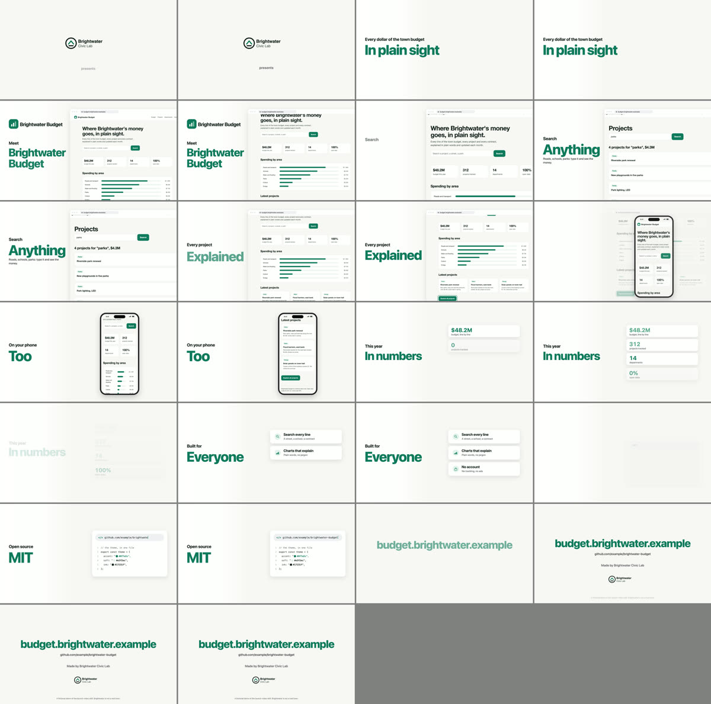
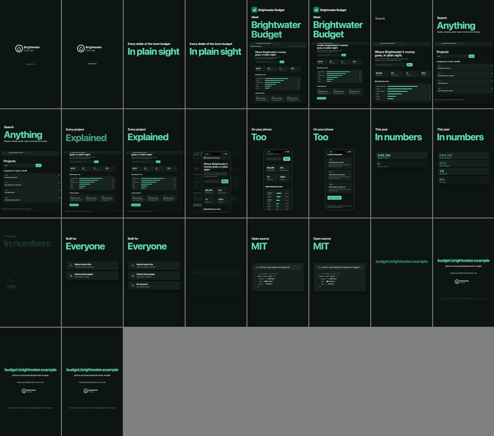

# launch-video

A [Claude Code](https://claude.com/claude-code) skill that makes launch videos for apps and websites: horizontal
16:9 for YouTube, X and LinkedIn, vertical 9:16 for Instagram Reels, TikTok and YouTube Shorts, in light and dark.

It interviews you first (what you are launching, where it will be posted, how long, what to show, who signs it),
reads your real site, writes a scene-by-scene storyboard for your approval, then captures the site like a screen
recording and renders it locally:

- big titles that land on the beat, word by word;
- your site in a browser window, with the camera panning and zooming;
- your search field typing a query and showing the real result page;
- the mobile site scrolling inside a phone;
- numbers counting up, feature cards with icons, an "open source" code card, a logo reveal, an end card;
- original music synthesised in time with the cuts (no samples, no stock audio), mastered to -14 LUFS;
- a master-quality MP4: H.264 CRF 10, BT.709, AAC 320 kbps, 30 fps.

One `video.json` drives both formats and both themes. Nothing is generated by an AI image or video model: every
frame is drawn by code from real screenshots, so what you see is your product.

| 16:9, light | 9:16, dark |
|---|---|
|  |  |

*Contact sheets of the bundled demo, a frame every 2 s. "Brightwater Budget" is a fictional town budget site.*

## The intake questions

Before anything is built, the skill asks (in your language, two short rounds at most):

1. What are you launching, and where is it (link, local folder or your own screenshots)?
2. What must the video do: announce, show how it works, get people to try it, get contributors?
3. Where will it be posted (decides 16:9, 9:16 or both)?
4. How long (about 30 s, 45 to 60 s, 75 to 90 s)?
5. Language, light or dark, what to show (home page, search in use, phone, real numbers, features, open source),
   tone and music, who signs it, colours and font, anything to avoid.

Then it shows a storyboard (every scene with its time and words) and waits for your OK, and shows contact sheets
before the final render. Numbers in the video come only from your site or from you.

## Install

```bash
git clone https://github.com/Matteoikarieth96/launch-video-skill ~/.claude/skills/launch-video
python3 ~/.claude/skills/launch-video/scripts/doctor.py
```

Needs Node 22 or newer, Python 3.9+ with numpy (`pip install numpy`), ffmpeg with libx264, and Google Chrome or
Chromium. No npm packages: Chrome is driven over its DevTools protocol with Node's built-in WebSocket.

## Usage

In Claude Code, ask for it in your own words, e.g. *"make a launch video for my site"* or *"fammi il video di lancio
dell'app, anche verticale per Instagram"*. The skill asks its questions, shows the storyboard, then contact sheets,
then renders `out/<name>-<format>-<theme>.mp4`.

To try it by hand with the fictional demo:

```bash
python3 ~/.claude/skills/launch-video/scripts/new_video.py ~/videos/demo --example
cd ~/videos/demo
python3 engine/build.py                                   # check video.json, print the scenes
node engine/capture.mjs                                   # screenshot the pages, both themes
python3 engine/music.py                                   # audio/music.wav
node engine/render.mjs sheet --format all --theme all     # previews/<format>-<theme>/sheet.png
node engine/render.mjs full --format all --theme all      # out/*.mp4
```

The storyboard format is documented in [references/storyboard.md](references/storyboard.md), the interview in
[references/interview.md](references/interview.md).

## How it works

- `engine/build.py` validates `video.json` (standard library only) and writes the data the other steps read.
- `engine/capture.mjs` opens only the URLs in `video.json` in headless Chrome, with the system light or dark theme
  emulated and animations off, and saves tall PNG tiles plus the position of the elements you named.
- `engine/core.js` and `engine/scenes.js` draw each frame on a canvas as a pure function of time, so a render is
  repeatable frame for frame.
- `engine/render.mjs` draws frames in several Chrome workers and pipes them in order to ffmpeg.
- `engine/music.py` synthesises the soundtrack with numpy from the same beat grid and measures loudness with
  ffmpeg's `ebur128` filter.

Every Chrome it starts gets a throwaway profile, `--use-mock-keychain --password-store=basic` (no macOS Keychain
prompt), and is closed when the script ends.

## Security

`video.json` is data: nothing in it is executed. Asset paths must stay inside the video folder, page paths inside
the local site folder, custom CSS cannot contain `<`, and the only action taken on a page is typing into the field
you name (and one Enter with `"submit": true`, meant for search fields). Chrome runs with a throwaway profile and
opens only the pages in `video.json`. Details and residual risks: [SECURITY.md](SECURITY.md).

## Limitations

- It films what a page shows without logging in: for an app behind a login, give your own tall screenshots
  (`"image"` on a page).
- No voice-over and no captions track: the titles carry the message. Add a voice-over in an editor if you want one.
- Nine scene types (text, page, phone, image, numbers, cards, code, logo, end) in a fixed visual style; colours,
  font, words, timing and camera are yours to set.
- Pages with heavy animations are captured still (animations are switched off for clean screenshots).
- Rendering speed depends on the machine: on a recent laptop a 50 s video takes well under a minute per format
  and theme.

## Tests

```bash
python3 -m unittest discover -s tests -v
```

The pipeline tests (capture, stills in both formats and themes, a short full render) run when Chrome, Node 22+
and ffmpeg are installed. CI runs everything on every push and pull request.

## More skills

- [cartoon-shorts](https://github.com/Matteoikarieth96/cartoon-shorts-skill): vertical animated cartoon shorts with a voice, music and an upload kit
- [whiteboard-video](https://github.com/Matteoikarieth96/whiteboard-video-skill): hand-drawn whiteboard explainer videos with voice-over
- [skill-release](https://github.com/Matteoikarieth96/skill-release-skill): publish a skill as a public GitHub repo without leaking anything, with an automated scan and independent review
- [adversarial-review](https://github.com/Matteoikarieth96/adversarial-review-skill): a panel of independent reviewer agents challenges finished work and returns one verdict
- [3d-print-design](https://github.com/Matteoikarieth96/3d-print-design-skill): parametric parts for FDM 3D printing, checked before export
- [ai-privacy-check](https://github.com/Matteoikarieth96/ai-privacy-check-skill): a first privacy and AI rules check for a use case in Italy and the EU, with a one-page report (in Italian)
- [beer-can-label](https://github.com/Matteoikarieth96/beer-can-label-skill): a print-ready full-wrap beer can label with a 3D can preview and a labelling QA pass
- [breadboard-wiring-guide](https://github.com/Matteoikarieth96/breadboard-wiring-guide-skill): step-by-step breadboard wiring guides for Arduino UNO beginners, one diagram per step and a USB call on every step
- [claude-time-is-relative](https://github.com/Matteoikarieth96/claude-time-is-relative): time estimates for Claude Code, learned from your own past sessions, on your own machine
- [evm-dd](https://github.com/Matteoikarieth96/evm-dd-skill): investor-angle due diligence on crypto and EVM projects, with a scored report and an A4 one-pager
- [hiring-prep](https://github.com/Matteoikarieth96/hiring-prep-skill): one interview prep page from a company, a role and your resume, with an interactive multiple-choice test
- [portfolio-report](https://github.com/Matteoikarieth96/portfolio-report-skill): an English portfolio report, an A4 one-pager and PDFs from a Fineco export, with a switch to hide the amounts
- [token-checkup](https://github.com/Matteoikarieth96/token-checkup-skill): a weekly token checkup for Claude Code: session size, what loads at session start, memory kept true
- [x2d-print](https://github.com/Matteoikarieth96/x2d-print-skill): STL parts to a ready-to-print Bambu Studio project for the Bambu Lab X2D, checked by a local slice, with a beginner guide
- [notion-todo](https://github.com/Matteoikarieth96/notion-todo-skill): run your Notion to-do lists from plain sentences, never mixing one list with another

## License

MIT, see [LICENSE](LICENSE).
